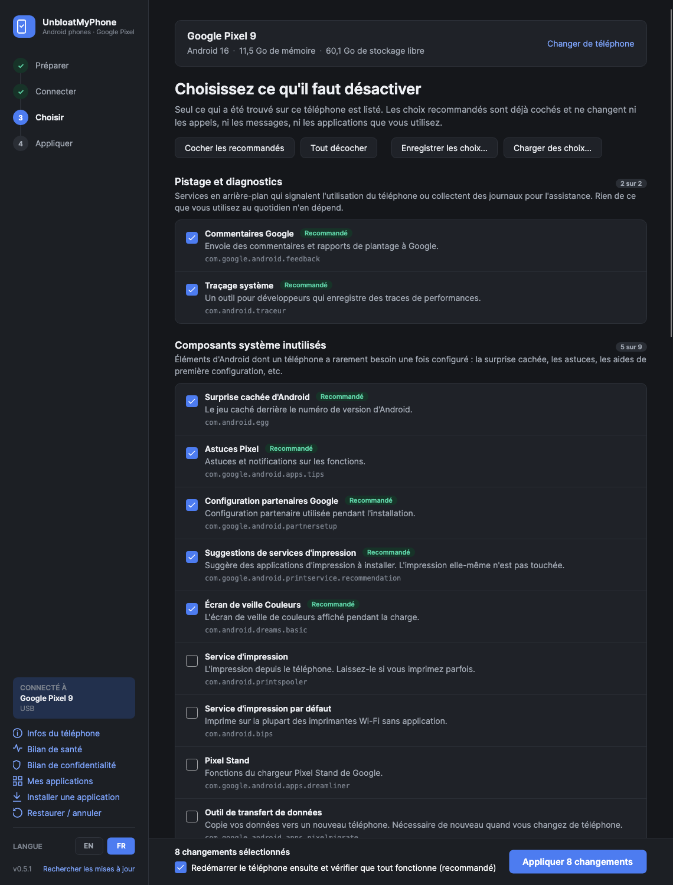

<h1 align="center">UnbloatMyPhone</h1>

  Désactivez les applications préinstallées, le pistage et les extras inutiles d'un téléphone Android. 
  Pour Windows, macOS et Linux. Des choix en langage clair, une sauvegarde de tout, une annulation en un clic.

  
  
  
  
   Le petit frère pour téléphones d'<a href="https://github.com/matguitarist/UnbloatMyTV">UnbloatMyTV</a>.
   <a href="README.md">English version</a>

> **Version préliminaire.** Optimisée d'abord pour les Google Pixel, avec une première série d'entrées Samsung. Voir
> [Téléphones pris en charge](#téléphones-pris-en-charge).

## En quatre étapes

1. **Préparer** : activez le débogage USB sur le téléphone. L'application vous montre comment.
2. **Connecter** : branchez-le, ou associez-le en Wi-Fi avec un code à 6 chiffres. Sans root.
3. **Choisir** : uniquement ce qui est sur *votre* téléphone, en mots simples, avec les choix sans
   risque déjà cochés.
4. **Appliquer** : tout est sauvegardé d'abord, puis le téléphone redémarre et est vérifié.
   Annulable à tout moment.

## Téléchargement

Prenez le fichier correspondant à votre ordinateur dans la **[dernière version](../../releases/latest)**.
Rien d'autre à installer : la première fois, l'application télécharge les outils ADB officiels de Google
(environ 7 Mo, depuis `dl.google.com`) dans son propre dossier. Ensuite, elle se met à jour toute seule.

| | Fichier | Premier lancement |
|---|---|---|
| **Windows** 10/11 | `UnbloatMyPhone.exe` | SmartScreen peut indiquer un éditeur inconnu (l'exe n'est pas encore signé) : **Informations complémentaires → Exécuter quand même**. Un Pixel peut avoir besoin du [pilote USB de Google](https://developer.android.com/studio/run/win-usb). |
| **macOS** 14+ | `UnbloatMyPhone-mac.zip` | Application native pour Apple silicon et Intel, signée et notarisée par Apple. Décompressez, placez-la dans Applications, ouvrez-la. |
| **Linux** x64 | `UnbloatMyPhone-x86_64.AppImage` | Rendez-le exécutable (`chmod +x`) et ouvrez-le. En USB, votre utilisateur peut avoir besoin d'accéder au téléphone (paquet `android-udev-rules` sur la plupart des distributions). |

## Avant de commencer, sur le téléphone

1. **Paramètres → À propos du téléphone** : touchez 7 fois **Numéro de build**, jusqu'à ce qu'il
   indique que vous êtes développeur.
2. **Paramètres → Système → Options pour les développeurs** : activez le **Débogage USB**.
3. Branchez le téléphone. Pas de câble ? Activez le **Débogage sans fil** dans le même menu, choisissez
   **Associer l'appareil avec un code d'association** et saisissez le code dans l'application.
4. Acceptez **Autoriser le débogage USB ?** sur le téléphone, en cochant *Toujours autoriser sur cet
   ordinateur*.

Le dernier écran désactive de nouveau le débogage une fois terminé.

## Ce qu'elle fait

### Nettoyer
- **Explique chaque choix** : diagnostics, composants système inutilisés, fonctions Google,
  applications préinstallées, réglages de vitesse et de confidentialité. Ce que vous pourriez utiliser
  (Photos, Maps, l'application Google…) reste décoché, avec un avertissement sur ce qui cesse de
  fonctionner.
- **Bloque publicités et traqueurs sur tout le téléphone** avec un DNS filtrant. Il est testé
  sur-le-champ, et le réglage précédent revient si les sites ne se chargent plus.
- **Ne touche jamais à ce dont le téléphone a besoin** : vos applications Téléphone et Messages, le
  clavier, l'écran d'accueil, les Paramètres, les services Google Play, les alertes d'urgence et le
  cœur d'Android.

### Garder propre
- **Remarque quand une mise à jour du système fait revenir des choses**, et les recoche en un clic.
- **Retient vos choix** pour votre prochain téléphone, et peut les enregistrer dans un fichier
  réutilisable partout.
- **Annule exactement n'importe quel passage** depuis Restaurer, ou réactive toutes les applications
  en un clic.

### Outils
| | |
|---|---|
| **Infos du téléphone** | Version d'Android, âge de la mise à jour de sécurité, la bêta et comment la quitter, bootloader et démarrage validé. Ouvre Mise à jour du système ou l'écran de réinitialisation, et redémarre le téléphone normalement, en mode récupération ou en mode bootloader (après confirmation). |
| **Bilan de santé** | Mémoire, stockage, processeur, les applications qui occupent le plus de mémoire et celles qui plantent en boucle, avec des conseils clairs. Lecture seule. |
| **Bilan de confidentialité** | Quelles applications peuvent utiliser votre position (et « en permanence »), le micro, l'appareil photo, les contacts, les SMS, le journal d'appels et l'agenda. Retirez un accès en un clic ; Restaurer le rend. |
| **Mes applications** | Vos applications avec leur icône et leur nom comme sur le téléphone, ainsi que leur taille, leur version, leur date d'installation et leur provenance. Celles qui ne viennent pas de Google Play sont listées et signalées. Ouvrez, forcez l'arrêt, désactivez, archivez (Android 15 et plus) ou désinstallez chacune. |
| **Installer une application** | Déposez un `.apk` sur la fenêtre. |
| **Restaurer / annuler** | Chaque passage sur ce téléphone, avec ce qu'il a changé. Annulez-en un, ou réactivez toutes les applications. |

Le nettoyage ne désinstalle rien : les applications sont désactivées avec la commande
`pm disable-user` d'Android, et une réinitialisation d'usine remet aussi tout en place. L'application
est en anglais et en français, et son thème clair ou sombre suit votre système.

## Écrans

| | |
|---|---|
|  |  |
|  |  |
|  |  |

Les captures montrent un téléphone et des applications fictifs.

## Téléphones pris en charge

| | |
|---|---|
| **Google Pixel** | La liste complète, testée sur un Pixel 7 Pro et un Pixel 10 Pro XL sous Android 17, profils professionnels compris. |
| **Samsung Galaxy** | Une première série d'applications Samsung et de composants à garder, testée sur un Galaxy A15 5G sous Android 15. D'autres modèles Galaxy peuvent avoir des applications que la liste ne connaît pas encore. |
| **Autres téléphones Android** | Les composants Android et Google. Les applications que la liste ne connaît pas sont affichées, et **Les proposer sur GitHub** aide à les ajouter pour tout le monde. |

## Comment elle reste sûre

- Seules les applications d'une liste vérifiée ([`shared/catalog.json`](shared/catalog.json)) sont proposées.
- Jamais proposés, quoi que dise la liste : les applications Téléphone et SMS par défaut, tout ce qui
  peut servir d'écran d'accueil, le clavier, l'application qui gère un profil professionnel ou un
  téléphone d'entreprise, les Paramètres, le Play Store, les services Google Play, WebView, la
  téléphonie, le Bluetooth, le NFC, les alertes d'urgence et le cœur d'Android.
- Chaque changement est inscrit dans une sauvegarde avec sa valeur d'origine *avant* d'être fait :
  même un passage interrompu peut être annulé.
- Les sauvegardes sont gardées dans ces dossiers, avec un instantané brut de tous les paquets et
  réglages, au même format sur tous les systèmes :
  - Windows : `%LOCALAPPDATA%\UnbloatMyPhone\backups`
  - Mac : `~/Library/Application Support/UnbloatMyPhone/backups`
  - Linux : `~/.local/share/UnbloatMyPhone/backups`
- Pour afficher les icônes et les noms dans Mes applications, un minuscule programme
  ([`helper/`](helper)) est copié dans le dossier temporaire du téléphone, lancé une fois puis
  supprimé. Rien n'est installé sur le téléphone.

## Confidentialité

L'application n'a ni compte, ni statistiques, ni serveur à elle. En plus de votre téléphone, elle ne
contacte que :
- `dl.google.com`, une fois, pour les outils ADB de Google ;
- `github.com`, pour vérifier s'il existe une nouvelle version (désactivable) et récupérer la dernière
  liste d'applications ;
- la page « nouveau ticket » de GitHub dans votre navigateur, seulement si vous cliquez sur **Les
  proposer sur GitHub**. Le modèle du téléphone et les identifiants des applications sont préremplis,
  et vous les relisez avant de publier.

## Pour les développeurs

Voir la [version anglaise](README.md#for-developers).

## Licence

MIT. À vos risques : l'application ne fait que désactiver et réactiver, mais c'est votre téléphone.
