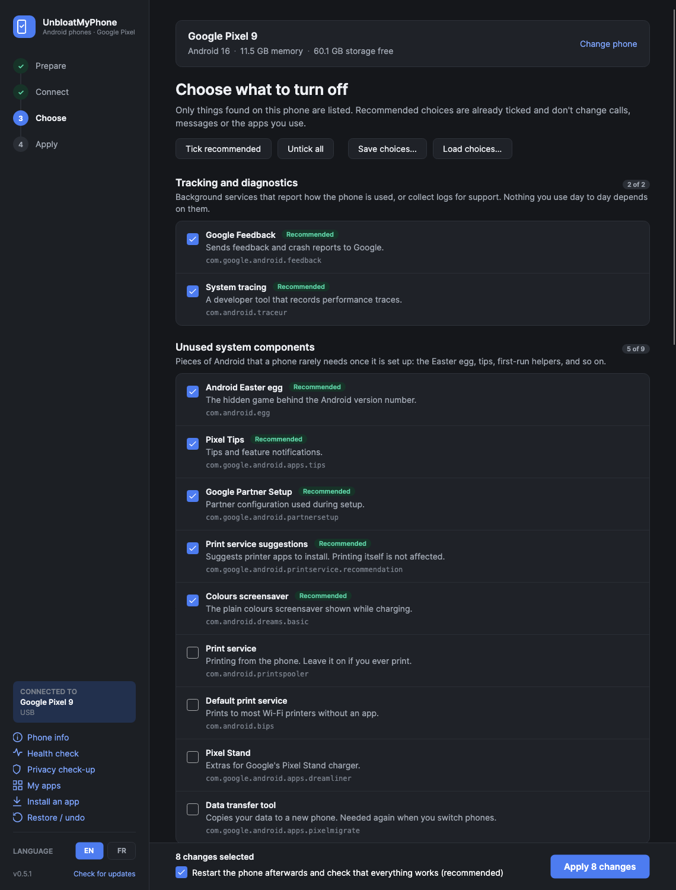
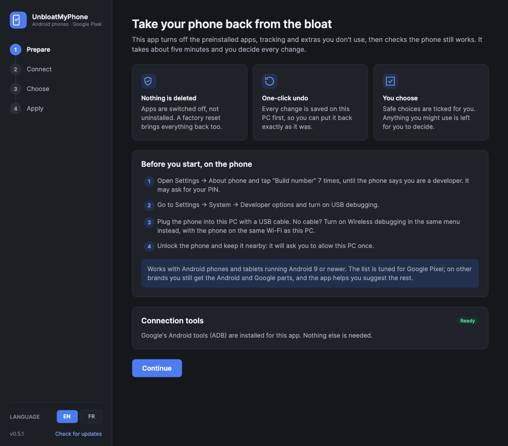
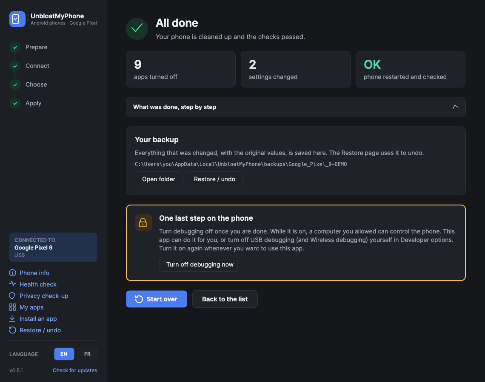
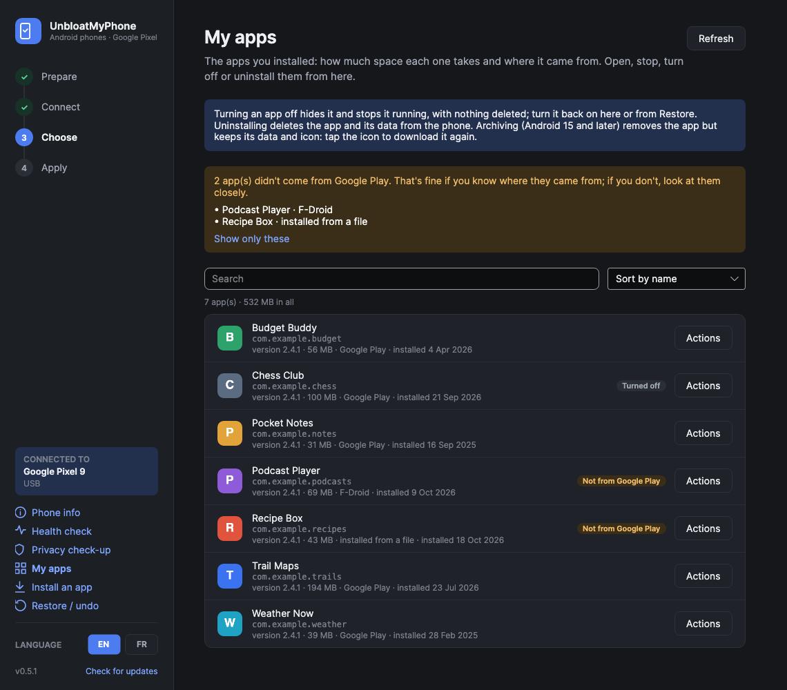
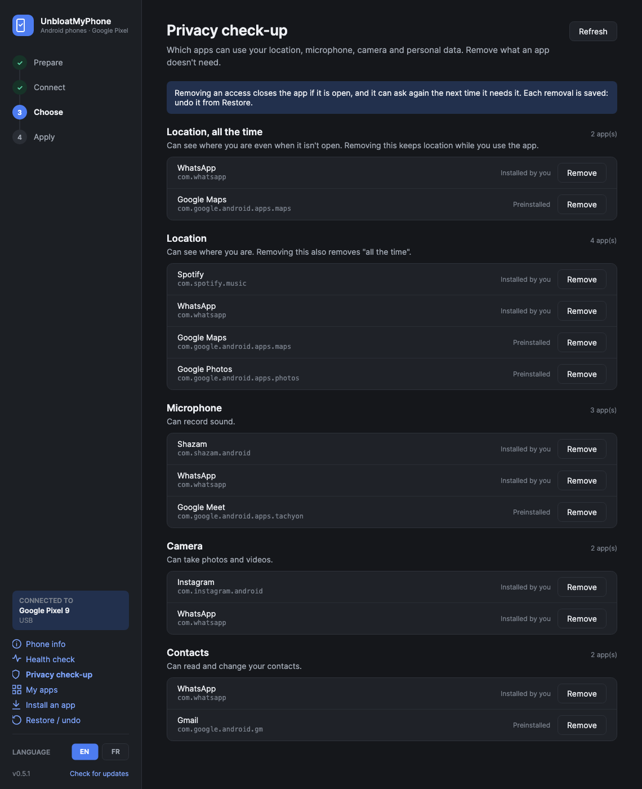
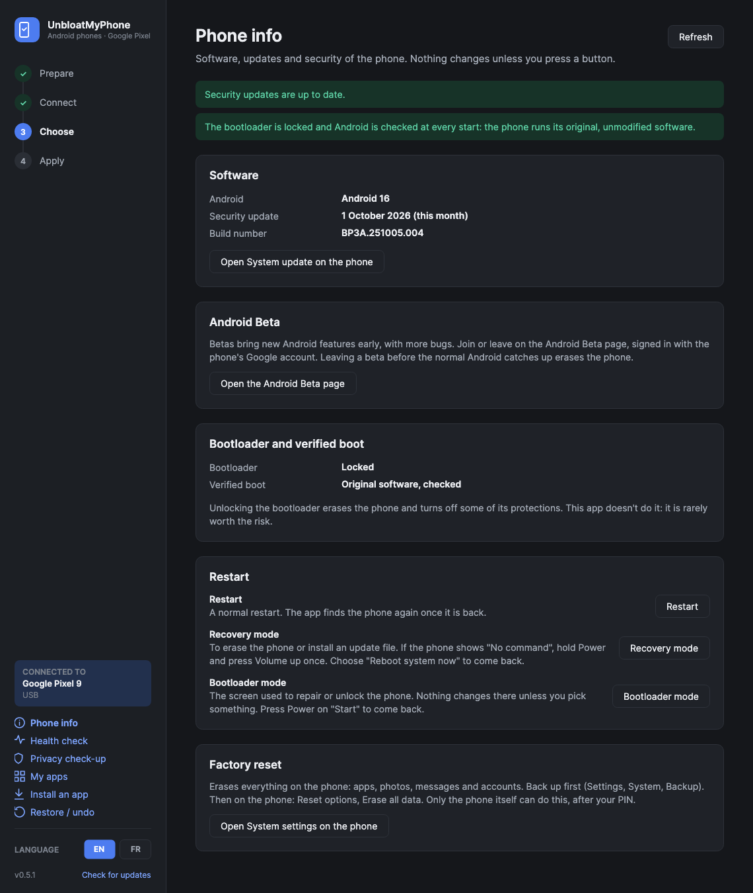
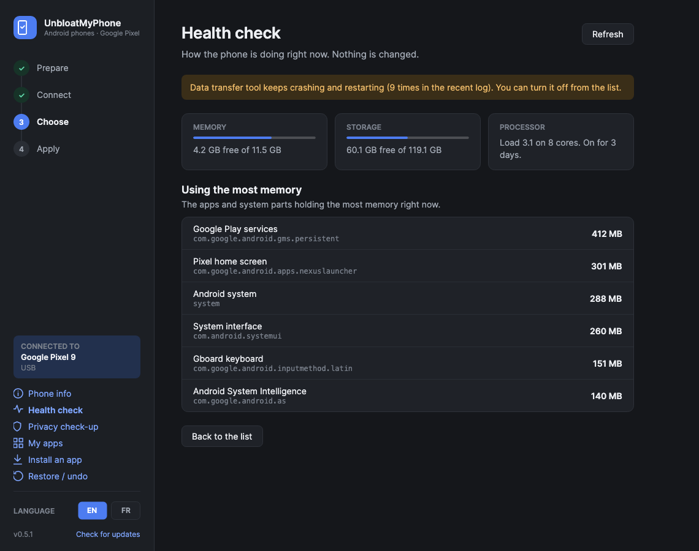

<p align="center"></p>

<h1 align="center">UnbloatMyPhone</h1>

<p align="center">
  Turn off the preinstalled apps, tracking and extras you don't use on an Android phone.<br>
  For Windows, macOS and Linux. Plain-language choices, a backup of everything, one-click undo.
</p>

<p align="center">
  <a href="../../releases/latest"></a>
  
  
  <a href="LICENSE"></a>
  <br><sub>The phone sibling of <a href="https://github.com/matguitarist/UnbloatMyTV">UnbloatMyTV</a>.</sub>
  <br><a href="README.fr.md">Version française</a>
</p>



> **Early version.** Tuned and tested on Google Pixel phones first. See [Supported phones](#supported-phones).

## In four steps

1. **Prepare**: turn on USB debugging on the phone. The app shows you how.
2. **Connect**: plug it in, or pair over Wi-Fi with a 6-digit code. No root needed.
3. **Choose**: only what is on *your* phone, in plain words, with the safe choices already ticked.
4. **Apply**: everything is backed up first, then the phone restarts and is checked. Undo any time.

## Download

Get the file for your computer from the **[latest release](../../releases/latest)**. Nothing else to
install: the first time, the app downloads Google's official ADB tools (about 7 MB, from
`dl.google.com`) into its own folder. After that, it updates itself.

| | File | First launch |
|---|---|---|
| **Windows** 10/11 | `UnbloatMyPhone.exe` | SmartScreen may say the publisher is unknown (the exe isn't code-signed yet): **More info → Run anyway**. A Pixel may need [Google's USB driver](https://developer.android.com/studio/run/win-usb). |
| **macOS** 14+ | `UnbloatMyPhone-mac.zip` | Native app for Apple silicon and Intel, signed and notarized by Apple. Unzip, move it to Applications, open it. |
| **Linux** x64 | `UnbloatMyPhone-x86_64.AppImage` | Make it executable (`chmod +x`) and open it. For USB, your user may need access to the phone (the `android-udev-rules` package on most distributions). |

## Before you start, on the phone

1. **Settings → About phone**: tap **Build number** 7 times, until it says you are a developer.
2. **Settings → System → Developer options**: turn on **USB debugging**.
3. Plug the phone in. No cable? Turn on **Wireless debugging** in the same menu, choose **Pair device
   with pairing code**, and type the code in the app.
4. Accept **Allow USB debugging?** on the phone, with *Always allow from this computer* ticked.

The last screen turns debugging off again when you are done.

## What it does

### Clean up
- **Explains each choice**: diagnostics, unused system parts, Google features, preinstalled apps,
  and speed and privacy settings. Anything you might use (Photos, Maps, the Google app…) is left
  unticked, with a warning that says what stops working.
- **Blocks ads and trackers on the whole phone** with a filtering DNS. It is tested on the spot and
  the previous setting comes back if websites stop loading.
- **Never touches what the phone needs**: your Phone and Messages apps, the keyboard, the home screen,
  Settings, Google Play services, emergency alerts and the core of Android.

### Keep it clean
- **Notices when a system update brings things back**, and ticks them again in one click.
- **Remembers your choices** for your next phone, and can save them to a file to reuse anywhere.
- **Undoes any run exactly** from Restore, or turns every app back on in one click.

### Tools
| | |
|---|---|
| **Phone info** | Android version, how old the security update is, the beta and how to leave it, bootloader and verified boot. Opens System update or the reset screen, and restarts the phone normally, into recovery or into bootloader mode (after asking). |
| **Health check** | Memory, storage, processor, the apps using the most memory and apps stuck in a crash loop, with plain advice. Read-only. |
| **Privacy check-up** | Which apps can use your location (and "all the time"), microphone, camera, contacts, texts, call log and calendar. Remove an access in one click; Restore gives it back. |
| **My apps** | Your apps with their icon and name as on the phone, plus size, version, install date and where each came from. Apps that didn't come from Google Play are listed and marked. Open, force stop, turn off, archive (Android 15+) or uninstall each one. |
| **Install an app** | Drop an `.apk` on the window. |
| **Restore / undo** | Every past run on this phone, with what it changed. Undo one, or turn every app back on. |

The clean-up uninstalls nothing: apps are switched off with Android's own `pm disable-user`, and a
factory reset brings everything back too. The app is in English and French, and its light or dark
theme follows your system.

## Screens

| | |
|---|---|
|  |  |
|  |  |
|  |  |

The screenshots use a made-up phone and made-up apps.

## Supported phones

| | |
|---|---|
| **Google Pixel** | The full list, tested on a Pixel 7 Pro and a Pixel 10 Pro XL on Android 17, work profiles included. |
| **Samsung Galaxy** | A first set of Samsung apps and parts that must be kept. Not tested on a real Galaxy yet. |
| **Other Android phones** | The Android and Google parts. Apps the list doesn't know are shown, and **Suggest them on GitHub** helps add them for everyone. |

## How it stays safe

- Only apps in a reviewed list ([`shared/catalog.json`](shared/catalog.json)) are offered.
- Never offered, whatever the list says: the default Phone and SMS apps, anything that can be the
  home screen, the keyboard, the app that manages a work profile or company phone, Settings, the Play
  Store, Google Play services, WebView, telephony, Bluetooth, NFC, emergency alerts and the core of
  Android.
- Every change is saved to a backup with its original value *before* it is made, so even an
  interrupted run can be undone.
- Backups are kept in these folders, with a raw snapshot of all packages and settings, in the same
  format on every system:
  - Windows: `%LOCALAPPDATA%\UnbloatMyPhone\backups`
  - Mac: `~/Library/Application Support/UnbloatMyPhone/backups`
  - Linux: `~/.local/share/UnbloatMyPhone/backups`
- To show icons and names in My apps, a tiny helper ([`helper/`](helper)) is copied to the phone's
  temp folder, run once and deleted. Nothing is installed on the phone.

## Privacy

The app has no account, no analytics and no server of its own. Besides your phone, it only contacts:
- `dl.google.com`, once, for Google's ADB tools;
- `github.com`, to check for a new version (you can turn this off) and to fetch the latest list of apps;
- GitHub's "new issue" page in your browser, only when you click **Suggest them on GitHub**. The
  phone model and app IDs are filled in, and you review them before posting.

## For developers

| | |
|---|---|
| **Windows and Linux app** | `src/`, C# with Avalonia. Needs the [.NET 10 SDK](https://dotnet.microsoft.com/download). |
| **Mac app** | `mac/`, Swift and SwiftUI, updates with [Sparkle](https://sparkle-project.org). Needs Xcode. Its text comes from `Strings.cs`. |
| **List of apps** | `shared/catalog.json`, used by both apps and fetched live from `main`. |
| **Phone helper** | `helper/`, a few lines of Java built into `ump-helper.dex` by `helper/build.sh`. |

```sh
dotnet run --project src/UnbloatMyPhone                               # run it (any system)
dotnet publish src/UnbloatMyPhone -c Release -r win-x64 -o publish    # single Windows exe
linux/build-appimage.sh                                               # AppImage (on Linux)
mac/build-app.sh                                                      # Mac app
python3 tools/gen-mac-strings.py                                      # after changing Strings.cs
```

**Changing the list.** Each entry has a package `id` (or a `prefix`), a `group`, `recommended`, and
a `name` and `description` (plus an optional `warning`) in English and French. Settings and the
`keep` list live there too. Only mark something `recommended` if switching it off changes nothing
anyone would notice, and test it on a real phone first. Then **increase `version`**: every installed
copy picks up the new list.

**Releases.** Bump `<Version>` in the csproj and push an annotated tag such as `v0.6.0`. GitHub
Actions builds all three apps, signs and notarizes the Mac app, and publishes the release. The tag
message becomes the notes shown in the update window.

## Licence

MIT. Use at your own risk: the app only switches things off and back on, but it is your phone.
